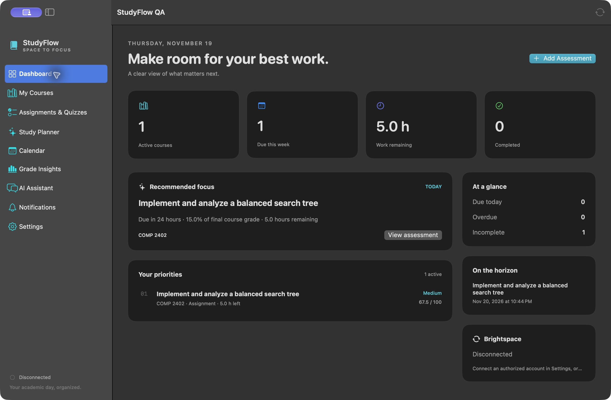
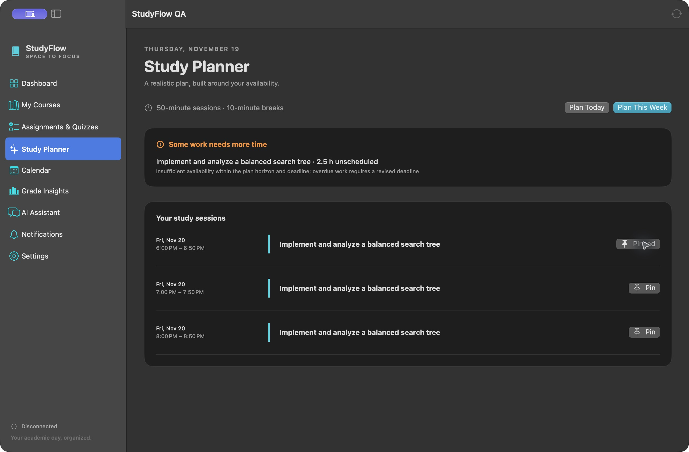

# StudyFlow

A Java-powered, native macOS academic planner. StudyFlow brings coursework, explainable priorities, realistic study sessions, and optional AI guidance into one local workspace.

**Status:** working local release with automated tests and an inspected SwiftUI interface. Brightspace and cloud AI adapters are implemented but have not been verified against live accounts. This is not yet a signed, notarized commercial release; see [delivery status](docs/DELIVERY_STATUS.md) for remaining work.

## Actual application

These screenshots show the running release app with an explicitly labeled, isolated QA fixture, not a production seed or a mockup. A new installation starts empty.




## Features in this build

- Native SwiftUI sidebar, dashboard, course cards, searchable/filterable assessments, detail editing, calendar, grade charts, notifications, and settings.
- Java 21-compatible backend; SQLite transactions and versioned schema; personal notes and workload metadata separated from source records.
- Deterministic priority scores with urgency, known final-course weight, workload risk, progress, and readable explanations.
- Daily/weekly scheduling with break-safe reservations, pinned conflict warnings, automatic replanning after elapsed sessions/day changes, and explicit unscheduled work.
- Study history with exactly-once, user-confirmed progress credit. Elapsed sessions remain unconfirmed until you log the work.
- Preview-and-confirm `.ics` calendar imports with stable course/UID identities, preserved personal metadata, and no network requests.
- Brightspace read-only course, assignment, and quiz adapter; pagination, stable identities, atomic reconciliation, retry backoff, and permission errors.
- Registered personal-app OAuth authorization-code flow and refresh-token rotation, using macOS Keychain. Token-only configuration is also available.
- Question-specific local assistant: deadline counts, course workload, priority explanations, and feasible day/time-budget previews. Optional HTTPS chat-completions provider with consent and local fallback.
- Menu-bar window reopening, light/dark/system appearance, bounded Java-process recovery, private notifications, configured-zone quiet hours, and an opt-in macOS login item.

## Open the built app

The repository contains source code; generated app bundles are excluded. After building locally, open `dist/StudyFlow.app`. Java 21 or later must be installed unless a runtime has been bundled. The delivered binary is Apple Silicon and targets macOS 14 or later; it was compiled and launched on this Mac's macOS 27 SDK environment. Compatibility with older OS releases still requires testing.

The generated application is locally ad-hoc signed. Distribution to another Mac requires proper Developer ID signing/notarization, or building locally. Do not disable Gatekeeper.

## Build from source

Requirements: macOS 14+, a Swift toolchain with the macOS SDK (Swift 5.9+), JDK 21+, Maven 3.9+, and network access for initial Maven dependencies. Full Xcode is recommended for release signing and UI test automation; this build was compiled with Command Line Tools.

```sh
mvn test
bash scripts/build.sh
open dist/StudyFlow.app
```

`MAVEN=/path/to/mvn` overrides Maven. `MAVEN_ARGS` can supply Maven options such as `-Dmaven.repo.local=/path/to/cache`. Swift has no third-party package dependencies.

To bundle your own compatible redistributable Java runtime on a fresh output directory:

```sh
STUDYFLOW_BUNDLE_JAVA_HOME=/path/to/jdk bash scripts/build.sh
```

Verify the JDK vendor's redistribution terms. Runtime bundling has not been exercised in this session. The normal build uses the installed Java runtime.

For standalone backend development:

```sh
mvn package
export STUDYFLOW_LOCAL_TOKEN="$(openssl rand -hex 32)"
export STUDYFLOW_DATA_DIR="$(mktemp -d)"
java --enable-native-access=ALL-UNNAMED -jar backend/target/studyflow-backend-1.0.0.jar
```

The native app normally generates a fresh token and random backend port for each launch. The standalone backend defaults to loopback port 18743. Do not put credentials in command arguments or source files. OAuth token persistence is available through the packaged native helper, not a bare Java launch.

## First use

1. Open **My Courses → Add Course**, then add assessments. You can use all local planning functions without a Brightspace connection.
2. Enter realistic estimated hours, progress, deadlines, and any known final-course weights. Imported work starts with an explicitly disclosed two-hour estimate.
3. In **Settings**, save study days, hours, time zone, session duration, and breaks.
4. Review Dashboard rankings and Study Planner. Pin a session to preserve it across regenerated plans. Updating assessments, availability, or successfully synchronizing recalculates the weekly plan.
5. Record completion yourself. Scheduling a session does not imply work was completed. After a session ends, **Study Planner → Recent study history → Log completed work** credits its duration once, capped at the remaining estimated work. It does not mark coursework submitted.
6. If you have an authorized `.ics` export, use **My Courses** or **Assignments & Quizzes → Import Calendar**. Select a destination course, preview all events, and explicitly confirm that their start times represent deadlines. Individual events with UID/SUMMARY/DTSTART are supported; recurring, cancelled, malformed, or ambiguous local-time events are rejected as a whole. All-day dates use the start of the day. Re-importing the same UIDs updates source fields while preserving notes/estimates; omitted events are not deleted.

A course is required before adding assessments. Notes and estimates remain local user-owned metadata. A remote item that disappears is retained and labeled no longer visible; it is excluded from active recommendations.

## Remove a course

In **My Courses**, choose **Remove Course** and confirm. This permanently removes the course and its local assignments, quizzes, notes, grades, scheduled sessions (including pinned sessions), and study history. Other courses are preserved. There is no undo; back up your local data first if you need to keep it.

Remote course records are not deleted from Brightspace. Removed imported courses are excluded from later syncs, including after restarting StudyFlow. Restoring an excluded imported course is not yet exposed in the UI.

## Brightspace connection

See the [Brightspace setup guide](docs/BRIGHTSPACE_SETUP.md) if you only have a normal student login.

Institutional permission is a prerequisite, not something StudyFlow can grant. Ask the institution's Brightspace administrator whether a personal OAuth integration is permitted, which API versions and scopes are available, and which student-role permissions apply.

For the registered-app route, the registration must allow authorization-code grants, the exact redirect `http://127.0.0.1:18744/oauth/callback`, appropriate read scopes, and refresh tokens if background renewal is desired. Enter your own approved client ID and secret in Settings, then select **Sign In with Registered App**. Your university password belongs only on the institution's normal sign-in page. Never distribute a shared client secret inside the application.

Default requested scopes are `enrollment:own_enrollment:read`, `dropbox:folders:read`, and `quizzing:quizzes:read`; confirm the exact requirements with the administrator. API versions are configurable. The callback port must be free and approved as a redirect. If loopback redirect registration is not allowed, this flow cannot be enabled unchanged.

An existing authorized access token can alternatively be entered in Settings. Token-only access expires and cannot refresh automatically. Disconnect removes locally stored credentials and stops synchronization while retaining academic records. To revoke institutional consent, use Brightspace's account application settings.

The adapter currently fetches active course offerings, assignment and quiz titles/deadlines, source links, displayable descriptions/instructions, availability windows, and assignment point denominators. Hidden assignments are excluded. Points remain source information rather than inferred final-course weights. It does **not** yet fetch gradebook rules, published grades, submission status, or individualized special-access overrides. Consequently, confirm deadlines in Brightspace, especially if you have accommodations. Grade values and weights in this version are explicitly entered by the user. A partially failed fetch never replaces the previous snapshot.

Official references reviewed on November 19, 2026: [OAuth registration](https://docs.valence.desire2learn.com/basic/oauth2.html), [enrollments](https://docs.valence.desire2learn.com/res/enroll.html), [assignment folders](https://docs.valence.desire2learn.com/res/dropbox.html), and [quizzes](https://docs.valence.desire2learn.com/res/quiz.html). No Carleton credentials, API registration, or live access were available during development. No scraping or login bypass is implemented.

## AI configuration and privacy

In Settings, enter the full HTTPS chat-completions endpoint, model identifier, and API key from a compatible provider. Review the disclosure and explicitly enable cloud AI. Keys are stored in Keychain; Java holds them in memory for requests. Provider charges and retention policies apply.

Only pressing **Ask** triggers a provider request. Context includes the question, an authoritative local calculation/preview, total active-work count, up to 12 priority summaries (titles, course codes, deadlines, scores and explanations), and up to 12 upcoming sessions with times and pin status. Personal notes, imported source descriptions, course materials, earned grades, and conversation history are excluded. Replies are capped at 700 output tokens; context is bounded. Requests time out and fall back to deterministic local priorities. No model response changes stored academic data. Clear Conversation removes the in-memory displayed conversation; each request is independent.

## Data, security, and background behavior

- Default database: `~/Library/Application Support/StudyFlow/studyflow.db`. The data directory is private to the OS user. SQLite is not independently encrypted; use macOS account protection/FileVault as appropriate.
- Credentials: macOS Keychain service `app.studyflow.credentials`. OAuth rotation writes through `CredentialHelper` over stdin, never command-line secret arguments. Keychain may request approval for a freshly signed build or its helper.
- Local API: `127.0.0.1` only, per-launch bearer token, no CORS, browser Origin rejection, bounded JSON bodies, and generic internal errors.
- The Java child exits when the native app quits or dies. Unexpected child exits trigger at most three automatic restart attempts with fresh local tokens/ports; repeated failures expose Retry. Closing the window keeps the menu-bar app alive. No hidden LaunchAgent is installed.
- Login startup is opt-in via macOS ServiceManagement. Its actual registration and notification permission delivery have not been verified in this development session.
- Polling runs only while the process is alive, the computer is awake, the network is available, and authorization remains valid. This is periodic polling, not real-time push.
- Schema version 2 preserves version-1 records and creates a consistent `studyflow.db.before-v2.db` backup before upgrading an existing version-1 database. New installations start directly on version 2.
- Back up the data directory with StudyFlow fully quit. Credentials require separate Keychain handling and are not included in database backups.

## Engineering and verification

See [architecture](docs/ARCHITECTURE.md), [API contract](docs/API.md), [verification record](docs/VERIFICATION.md), [delivery checklist](docs/DELIVERY_STATUS.md), and [AI-assisted engineering log](AI_DEVELOPMENT_LOG.md).

Run `mvn test` for the account-free unit and integration suite (77 tests as of November 20, 2026). Tests use temporary SQLite files, simulated Brightspace/provider responses, and local ephemeral HTTP ports. OAuth callback tests use loopback port 18744. No ordinary test uses a university account or cloud API key.

Code coverage and production performance have not been measured. No claims of live synchronization reliability or universal macOS compatibility are made.
