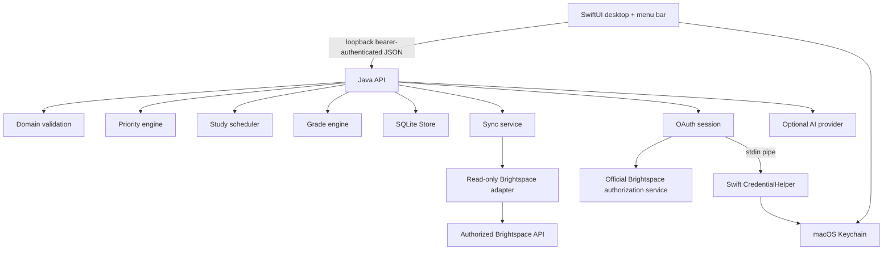

# Architecture

## Decision

Java owns domain values, validation, SQLite access, synchronization, OAuth, scoring, scheduling, grade math, AI requests, and the authenticated HTTP API. SwiftUI owns presentation, lifecycle, notifications, login integration, and credential entry. A tiny Swift helper writes rotated OAuth credentials into Keychain via Security.framework.

A JDK HTTP server plus JDBC is intentionally smaller than a Spring/JPA stack for this single-user local application. Jackson supplies strict JSON parsing; SQLite JDBC supplies the embedded database; JUnit supplies account-free tests. This choice avoids a framework dependency graph while retaining explicit service boundaries. The backend compiles with Java release 21.



## Source layout

`backend/src/main/java/app/studyflow` contains compact service classes. `Domain` contains immutable validated records. `Store` serializes its JDBC connection and uses explicit transactions. `PriorityEngine`, `Scheduler`, and `GradeEngine` have no UI or network dependencies. `Brightspace.Transport`, `SyncService.Source`, `OAuthSession.Exchange/Vault`, and `AssistantService.Provider` provide testable integration boundaries. `Api` composes these services; `Main` configures process ownership and local storage.

`macos/Sources/StudyFlow` separates transport/lifecycle from models and views. `CredentialHelper` accepts a bounded JSON document through stdin and stores only the fixed OAuth Keychain account. A `ViewState` alias explicitly selects SwiftUI's stable property wrapper because this Mac's SDK declares a State macro whose plugin is absent in Command Line Tools.

## Database

Version 1 is applied from `schema.sql`; version 2 from `migration-2.sql`, each transactionally. Existing version-1 databases receive a consistent SQLite `VACUUM INTO` backup before migration. Startup rejects a newer schema version instead of attempting a downgrade. Future versions should append migrations and preserve backups.

| Table | Purpose |
|---|---|
| courses | Course identity, code, name, term, source, URL |
| assessments | Stable source identity, course FK, title, kind, deadline, visibility flag |
| assessment_metadata | One-to-one personal weight/grade values, estimate, worked hours, status, notes |
| sessions | Assessment FK, start/end instants, title, pinned flag |
| settings | Validated preferences, last successful sync, unscheduled summary |
| notices | Durable event IDs, content, timestamp, read state |
| schema_version | Applied database migration version |
| remote_details | Source descriptions, availability boundaries and raw point denominator, separate from personal metadata |
| session_history | Immutable session snapshot, unconfirmed/completed outcome, credited hours and recording time |

Credentials and AI secrets are excluded. Earned points and possible points are distinct from final-course weight. All dates in storage are UTC instants; scheduling availability uses an explicit IANA zone.

## Priority scoring

Default normalized weights: urgency 0.45, impact 0.25, workload feasibility 0.25, progress 0.05. Weights can be configured through the `PriorityEngine.Weights` constructor; no UI weight editor is currently exposed.

- Urgency: overdue = 1; known future deadline = `1/(1+hoursRemaining/48)`; missing deadline = 0.1.
- Impact: `min(1, finalCourseWeight/30)`; unknown = 0.25, clearly explained.
- Risk: remaining effort divided by estimated available daily study time until deadline, capped at 1. Without a deadline, use a seven-day capacity horizon.
- Progress: worked hours / estimated hours. This bounded tie influence helps near-finished work without dominating urgency.
- Score = 100 times the normalized weighted sum, rounded to one decimal. Stable ID resolves score ties. High >=70; Medium >=45.

Completed, submitted, and remotely missing work is excluded. Assessment type has no arbitrary coefficient. The feasibility estimate is a heuristic based on average daily configured hours, not an exact proof of remaining capacity; the scheduler performs the actual availability check. Unknown data is never promoted into factual grades.

## Scheduling

A deterministic priority-ordered greedy allocator fills configured local study windows with preferred session lengths and breaks. It subtracts future pinned reservations from remaining effort, avoids all pinned collisions, and never places generated work after a known deadline. Large tasks are split; unused fragments smaller than 15 minutes are generally skipped unless finishing a shorter remaining task. Availability boundaries are independently resolved through the configured zone for DST.

Replanning replaces future unpinned sessions and keeps future pinned and currently running sessions. Generated IDs derive from assessment/start/end so unchanged slots keep their reminder identities. It reports unmet hours rather than claiming an optimal schedule. Elapsed sessions are archived as UNCONFIRMED. Background maintenance checks once per minute and replans after elapsed sessions or local date changes. Only an explicit completion action credits effort, transactionally and once per session ID, capped at remaining estimated effort; coursework status is not automatically completed/submitted. Replanning is triggered by assessment edits, preference changes, successful synchronization, or explicit planning actions. Existing pinned work may reflect user choices inconsistent with a changed deadline; this build preserves that choice and reports conflicts rather than silently moving it. Conflicting reservations do not falsely satisfy the affected assessment’s remaining workload.

## Reconciliation

```mermaid
sequenceDiagram
    participant T as Polling timer
    participant B as Brightspace
    participant S as Store
    participant E as Engines
    T->>B: Read enrolled courses and all assessment pages
    alt any request fails
        B-->>T: Failure / permission / rate limit
        T->>T: Backoff or await reauthorization
    else complete snapshot
        B-->>T: Courses + assessments + source namespace
        T->>S: Begin transaction
        S->>S: Upsert source fields; preserve metadata
        S->>S: Flag absent items; retain records
        S->>S: Store events and success timestamp; commit
        T->>E: Recompute weekly plan
    end
```

IDs include the institution host, course ID, resource type, and remote ID. Repeated snapshots are idempotent. Failed or incomplete fetches do not reconcile. Disconnect increments a connection generation so an in-flight old snapshot cannot commit. Polling is serialized and scheduled without blocking sleep. Rate limits honor numeric Retry-After; exponential backoff is capped. Retry-After supports seconds and RFC 1123 HTTP dates, bounded to a maximum 30-day delay. Complete HTTP responses have body-size and wall-clock limits, including streaming bodies. Authentication/permission failures halt automatic retries until reconnect.

## OAuth and secret handling

The personal registered-app flow uses the official authorization and token endpoints. It binds a temporary loopback callback on port 18744 and uses a cryptographically random, ten-minute, single-use state. It never logs authorization codes or token bodies. The callback returns plain text, no scripts or external assets. The registered-app secret is supplied by the user and must not be shared in a distributed build. This follows the documented confidential-client authorization-code flow; it does not claim PKCE support from the institution.

Token refresh is serialized. The new credential set is saved through the Keychain helper before use, protecting single-use refresh-token rotation across ordinary restarts. A Keychain failure stops token acceptance; reauthorization may be necessary because the provider may already have consumed the old refresh token. The helper has a timeout. Callback registration, Keychain ACL prompts, and a live refresh remain acceptance gates requiring the real institution.

## AI boundary

Java produces authoritative scores. The provider receives a bounded JSON summary of at most 12 priorities, 12 upcoming sessions, aggregate active-work count, the current question and an authoritative local answer. The local assistant handles deadline counts across all records, course workload, priority explanations, and day/time-budget previews without writes. Task titles are labeled untrusted data. The provider has no tools or database write authority. Provider failures yield deterministic local priorities with a visible fallback notice. This is a stateless, compatible chat-completions client, not a promise that every vendor's extended API features are supported.

## Operational limits

The HTTP server uses six bounded worker threads and a local bearer secret. SQLite access is serialized; snapshot reads and API responses are assembled locally. The native app polls state every 15 seconds. This is appropriate for personal workloads, not a multi-user server. Large-collection backend testing is separate from visual testing; no resource or latency benchmarks are asserted.

## Calendar import boundary

`CalendarImport` implements a constrained RFC 5545 event reader. It handles folded lines, text escapes, UTC/local/IANA timestamps and all-day dates. It rejects recurrence/cancellation and ambiguous DST times rather than guessing. It never downloads attachments, URLs or feeds. Import preview is read-only; commit requires explicit event-start-as-deadline confirmation. The entire parsed batch is validated before an additive transaction. IDs derive from destination course and UID, so repeated imports preserve personal metadata and unrelated assessments. The selected preferences zone interprets floating/all-day dates. Imported descriptions are literal text, excluded from AI context.

## Recovery and Keychain lifecycle

The native app can restart an unexpectedly exited Java child at most three times with bounded delay. Fresh ports/tokens are generated per attempt; the same database is reopened. This handles child exits, not an indefinitely hung JVM. Menu-bar Show StudyFlow opens the named SwiftUI window even after the last window was closed. Credential updates use SecItemUpdate instead of delete/add. Disconnect stops the backend refresh path before deleting credentials, avoiding a race with rotated-token persistence. Isolated QA launches set `STUDYFLOW_ISOLATED_TEST=1` to skip all saved connection restoration.
